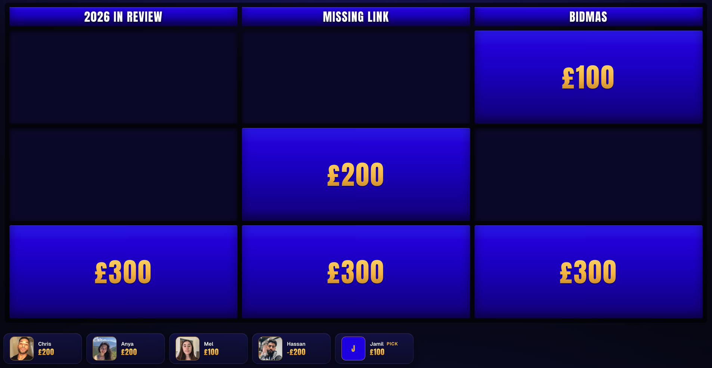
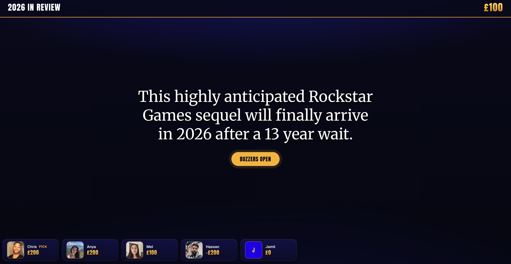
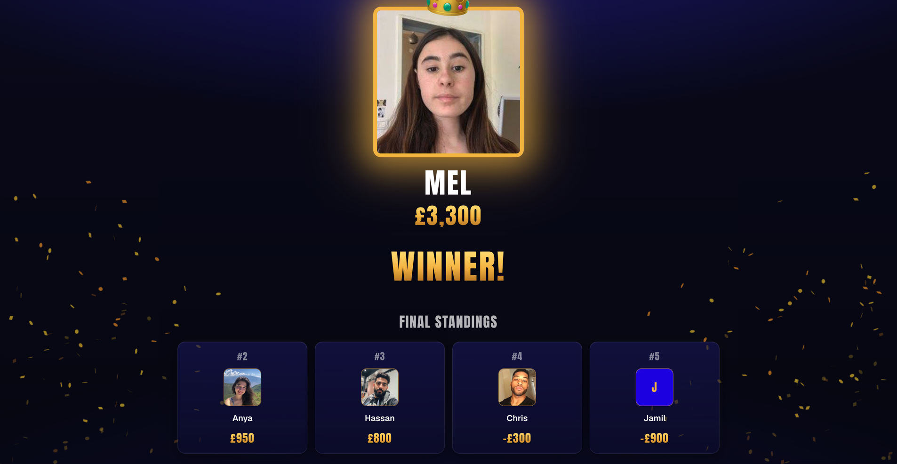

# Jeopardy

A Jeopardy-style quiz game you can run over a video call. The board goes on a laptop that you screen share, you run the game from your phone, and everyone else joins on their phones and buzzes in.

**Live:** https://jeopardy-topaz-eight.vercel.app/

## Screenshots



<p>
  
  
</p>

## How it works

There are three screens:

- `/host/[code]`: This is the board which shows the questions, timers, and scores. Open it on the screen you're sharing.
- `/admin/[code]`: Mark answers right or wrong, adjust scores, kick players, and run the final round from the admin panel. Good to run this on your phone.
- `/play/[code]`: Players join this link with a name and an optional selfie, then buzz in.

Both host screens need the admin password you set when creating the game.

Whoever gets a question right picks next. A wrong answer loses you the points and lets everyone else buzz again. If two people buzz within 150ms of each other, the player with the lower score gets it.

The final round is a few questions with rising stakes (e.g. x1, x1.5, x2). Everyone wagers before each question, and everyone can wager at least £1,000 so people at the bottom still have a shot.

## Running it locally

You'll need Node.js and a Firebase project with:

- a Firestore database, with the rules from `firestore.rules` deployed
- Anonymous sign-in enabled under Authentication
- a web app registered, for the client config
- a service account key, for the API routes

Copy `.env.example` to `.env.local` and paste in your values:

| Variable | What it is |
|----------|------------|
| `NEXT_PUBLIC_FIREBASE_API_KEY` | From the web app config |
| `NEXT_PUBLIC_FIREBASE_AUTH_DOMAIN` | From the web app config |
| `NEXT_PUBLIC_FIREBASE_PROJECT_ID` | From the web app config |
| `NEXT_PUBLIC_FIREBASE_APP_ID` | From the web app config |
| `FIREBASE_SERVICE_ACCOUNT_KEY` | The service account JSON, on one line |
| `CRON_SECRET` | Any random string. Protects the daily cleanup job in `vercel.json` that deletes old games |

Then:

```bash
npm install
npm run dev
```

To try it with real phones, open the dev server using your computer's local IP rather than localhost.

## Making a game

Go to `/new`, set a password, and paste or upload a game file. "Load Sample Game" fills in `sample-game.json` if you want something to start from.

```json
{
  "title": "Friday Quiz",
  "boards": [
    {
      "pointValues": [100, 200, 300],
      "categories": [
        {
          "name": "Missing Link",
          "cells": [
            { "question": "Black, Key, White", "answer": "Board" },
            { "question": "Gown, Stand, Club", "answer": "Night" },
            { "question": "Dial, Flower, Room", "answer": "Sun" }
          ]
        }
      ]
    }
  ],
  "final": {
    "questions": [
      { "category": "Greek Myth", "question": "...", "answer": "Poseidon" },
      { "category": "Formula One", "question": "...", "answer": "Schumacher or Hamilton" }
    ],
    "multipliers": [1, 2],
    "wagerFloor": 1000
  },
  "timers": {
    "answerSeconds": 10,
    "buzzWindowSeconds": null,
    "finalAnswerSeconds": 30
  }
}
```

- `boards`: one or more boards played in order. Every category needs one cell per point value. Up to 8 categories per board.
- `final.questions`: 1 to 5 final questions.
- `final.multipliers`: optional, one per final question. Defaults to 1, 2, 3... and can be fractional, e.g. 1.5.
- `final.wagerFloor`: optional, defaults to 1000. Everyone can wager at least this much.
- `timers.answerSeconds`: how long someone has to answer after buzzing. Defaults to 8.
- `timers.buzzWindowSeconds`: how long people have to buzz before the answer is revealed. `null` (the default) means no limit, and you end the question from the admin phone.
- `timers.finalAnswerSeconds`: time to type each final answer. `null` (the default) means no limit.

## Running a game

1. Create the game at `/new` and keep the three links it gives you.
2. Open the host link on your device, enter the password you created, and share that window on the call.
3. Open the admin link on another device like your phone.
4. Players scan the QR code on screen, or go to `/join` and type the code.
5. Once everyone's in, lock the lobby if you want, then hit **Start Game**.
6. The highlighted player picks a clue. Click it on the board and read it out. Judge whoever buzzes from your phone.
7. When the board's done, start the final round from the admin phone. For each question: collect wagers, reveal the question, then reveal everyone's answers (lowest score first) and mark them.
8. Hit **End Game** for the winner screen.

Refreshing any screen is fine and players who close the tab can reopen their link on the same phone and they'll be back in.
